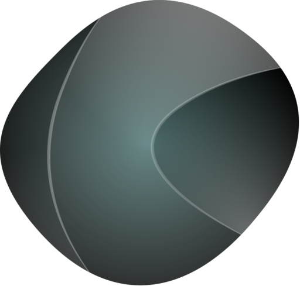

<p align="center">
  
  <h1 align="center">OnyxSDK</h1>
  <p align="center">
    <strong>A C++20 SDK for building game-asset tools: formats in, viewers and a renderer out, composed by your host.</strong>
  </p>
  <p align="center">
    
    
    
    
  </p>
</p>

---

## What it is

Onyx is a C++20 SDK for building game-asset tools. A module describes a game's formats; the SDK is meant to supply the virtual filesystem, the viewers, a Vulkan renderer, a CLI and a ready-made shell around it. Version 2 is being rebuilt layer by layer on branch `v2`; the Status section says what exists today.

## How it is built

Onyx is nine static libraries, each with its own `Source/<Layer>/` directory and public `include/` directory, and each linking only the layers below it. When v2 is complete the nine layers are: `Onyx::Core` (will hold the virtual filesystem, type identity, domain data, module contract, workspace, jobs, settings and logging), `Onyx::Gpu` (Vulkan ownership), `Onyx::Render` (scene renderer), `Onyx::Ui` (ImGui components drawn inside your own frame), `Onyx::Shell` (the ready-made application), `Onyx::Media` (video and audio), `Onyx::Cli` (stock verbs), `Onyx::Exchange` (glTF, PNG and WAV export) and `Onyx::TestKit` (goldens and synthetic fixtures); the layer contents described here are the plan; Status lists what exists today. A consumer names the layers it uses and links nothing else; there is no aggregate target. The figure of this stack is planned for W5.

## Status

v2 is in progress on branch `v2`. W0 (the skeleton) and W1 (Core) are done. What works today:

- **Core.** The virtual filesystem (OS, memory and slice files, ISO 9660 mounts, lz4), the type catalog, the game-agnostic domain model, the module contract with capability-aware decoders, the workspace that opens documents synchronously or on the job queue, jobs, events and diagnostics, atomic settings with a declared schema, and the declarative schema reader.
- **Cli.** The verb table and the stock verbs `probe`, `list`, `extract` and `decode`.
- **TestKit.** Tree goldens, the decode smoke check and the synthetic ISO builder.
- **OnyxBox.** A synthetic example module (`Onyx::ExampleBox`) with its container writer, used by the tests and by the consumer gate.

`Onyx::Gpu`, `Onyx::Render`, `Onyx::Ui`, `Onyx::Shell`, `Onyx::Media` and `Onyx::Exchange` still expose only `LayerName()`. W2 (Gpu and Render) is next. `legacy/` is the v1 tree and is not built. CI is defined for both OSes but has not yet run on a hosted runner.

## Build and run

```
py -3 tools/check.py                         # configure, build, ctest, lint; exit code is the verdict
py -3 tools/check.py --preset linux-release  # pick another preset
```

Presets: `windows-debug`, `windows-release`, `linux-debug`, `linux-release`; build trees go to `build/<preset>`. `check.py` finds the Visual Studio toolchain itself on Windows. See `tools/README.md` for its flags.

## Consuming Onyx

Onyx is consumed from source.

```cmake
include(FetchContent)
FetchContent_Declare(OnyxSDK
    GIT_REPOSITORY https://github.com/JeanxPereira/OnyxSDK.git
    GIT_TAG        v2)   # development branch; 2.0.0 will have a tag
set(ONYX_WITH_GPU OFF)   # only the non-graphical layers
FetchContent_MakeAvailable(OnyxSDK)

target_link_libraries(my_tool PRIVATE Onyx::Core)
```

A Core-only consumer (no GPU, UI or media, and none of their dependencies fetched) sets the options before `FetchContent_MakeAvailable`:

```cmake
set(ONYX_WITH_GPU OFF)
set(ONYX_BUILD_TESTS OFF)
set(ONYX_BUILD_EXAMPLES OFF)
FetchContent_MakeAvailable(OnyxSDK)

target_link_libraries(my_tool PRIVATE Onyx::Core)
```

The ctest entry `Consumer.CoreOnly` is the gate for this: it configures `Tests/Consumer/CoreOnly` as a separate top-level project against this checkout with `ONYX_WITH_GPU=OFF`, builds it, runs it, and fails if the consumer's `_deps` holds any volk, Vulkan, VMA, glslang, ImGui, GLFW, ffmpeg or ImPlot directory.

Component options: `ONYX_WITH_GPU` (Gpu and Render), `ONYX_WITH_UI`, `ONYX_WITH_SHELL`, `ONYX_WITH_MEDIA`. Turning a component off turns off those above it. Core, Cli, Exchange and TestKit always build; `-DONYX_WITH_GPU=OFF` drops Gpu, Render, Ui, Shell and Media, leaving only the non-graphical layers (Core, Cli, Exchange, TestKit), and a consumer that links `Onyx::Core` builds and links nothing GPU- or UI-related, and the configure fetches no GPU or UI third-party dependency. `ONYX_BUILD_TESTS`, `ONYX_BUILD_EXAMPLES` and `ONYX_BUILD_TOOLS` default to ON only when Onyx is the top-level project (`ONYX_BUILD_TOOLS` has no consumer yet).

## Where to look

| What | Where |
|---|---|
| Design of v2: layers, contracts, migration plan | [`docs/superpowers/specs/2026-10-30-onyx-v2-design.md`](docs/superpowers/specs/2026-10-30-onyx-v2-design.md) |
| Survey of the v1 tree that motivates it | [`docs/design/2026-10-30-refactor-survey.md`](docs/design/2026-10-30-refactor-survey.md) |
| Build verdict and lint | [`tools/README.md`](tools/README.md) |
| Rules for contributors and agents | [`CLAUDE.md`](CLAUDE.md) |
| The v1 tree, reference only | [`legacy/README.md`](legacy/README.md) |

---

<p align="center">Made by JeanxPereira</p>
