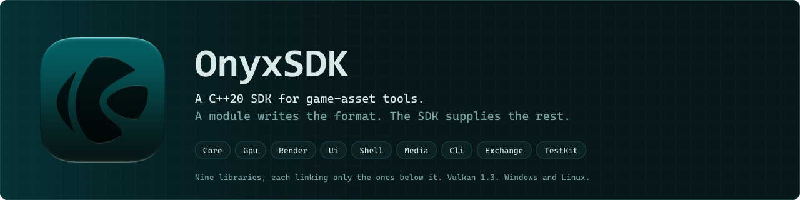
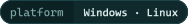
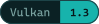
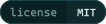
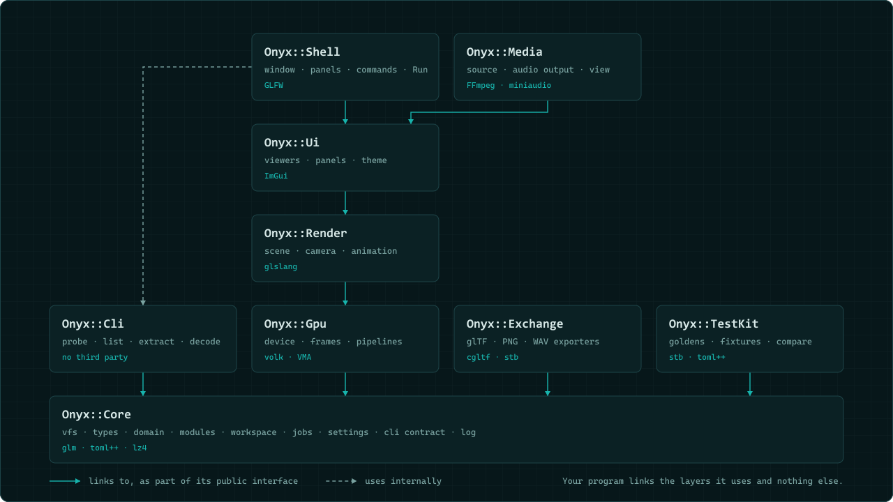
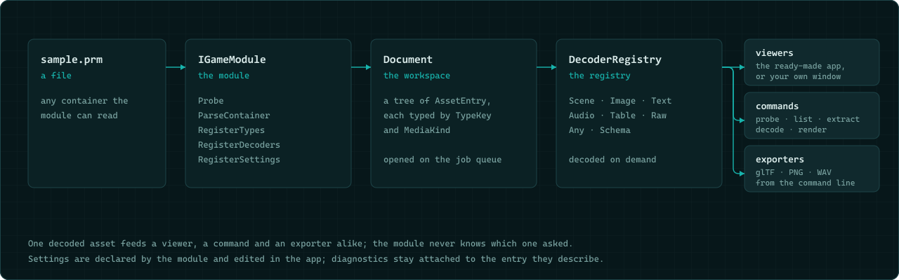
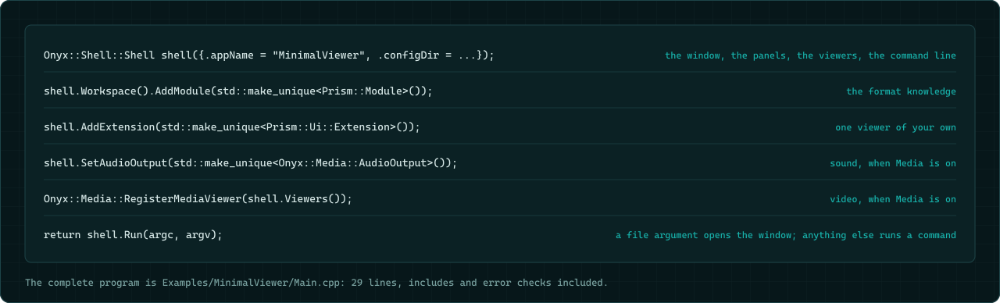

<div align="center">








<a href="https://github.com/JeanxPereira/OnyxSDK/actions/workflows/ci.yml"></a>

</div>

Games keep their art in their own file formats: archives, textures, models, skeletons, animations, sounds, video. Opening them takes a tool, and every such tool rebuilds the same things around the format: a file browser, an image viewer, a 3D view, an audio player, a command line, an exporter. Onyx is that surrounding tool, written once, as a library you link.

You write a **module**: how to recognise a file, how to walk its container, what each entry is and how to decode it. Onyx supplies everything else, and your module never has to know whether it is being asked by a window, a command or an export.

## 

<p align="center"></p>

Onyx is nine static libraries that stack. Each one links only the layers below it and keeps its own dependencies to itself: a program that uses only `Onyx::Core` compiles without Vulkan, ImGui or FFmpeg anywhere on its include path. There is no global state to initialise and no framework to inherit from; the only process-wide object is the log.

| Layer | What it gives you |
|---|---|
| `Onyx::Core` | The virtual filesystem (plain files, memory, slices, ISO images), the type catalog, the asset model, the module contract, the workspace with its job queue, settings with a declared schema, diagnostics and logging |
| `Onyx::Gpu` | A Vulkan device, either its own or one your program already owns, with buffers, images, uploads, pipelines and a swapchain |
| `Onyx::Render` | A scene renderer with camera, skinning, animation playback and overlays, on screen or into an image |
| `Onyx::Ui` | The panels and viewers as ImGui components you draw inside your own frame: documents, inspector, settings, image, text, mesh, audio, table, hex |
| `Onyx::Shell` | The finished application: a window, the panels, the stock commands, and a `Run` that opens a file or runs a command |
| `Onyx::Media` | Video and audio playback over FFmpeg and miniaudio, decoded on a thread of their own |
| `Onyx::Cli` | The `probe`, `list`, `extract` and `decode` commands |
| `Onyx::Exchange` | Export to glTF (meshes, skins, animations), PNG and WAV |
| `Onyx::TestKit` | Golden images and trees, synthetic fixtures and image comparison for your module's tests |

## 

<p align="center"></p>

A module registers the types it knows, each with a kind (image, text, mesh, audio, table, video, raw bytes) and a decoder for the kinds it can produce. When a file opens, the workspace asks the module to walk it and builds a tree of entries, decoding nothing yet. The first thing that needs an entry, a viewer, a command or an exporter, asks the registry for the decoded asset, and the result is the same object whoever asked. Anything a module cannot read is reported on the entry it belongs to, not thrown; the tree stays usable with the broken parts marked.

Two decoding slots go beyond the fixed kinds. A **schema** describes a raw record field by field, so the inspector shows it as a form without a line of viewer code. An **any** payload carries a type of the module's own under a named capability, so a module can ship an asset Onyx never heard of together with the viewer that understands it.

## 

<p align="center"></p>

```cmake
include(FetchContent)
FetchContent_Declare(OnyxSDK
    GIT_REPOSITORY https://github.com/JeanxPereira/OnyxSDK.git
    GIT_TAG        main)
FetchContent_MakeAvailable(OnyxSDK)

target_link_libraries(MyViewer PRIVATE Onyx::Shell Onyx::Media)   # or only Onyx::Core
```

Two ways in. **The Shell** is a complete application: give it your modules and call `Run`; a file argument opens the window, anything else runs a command, and the same binary serves both. **Your own window** links `Onyx::Ui` instead, draws the same panels inside the frame it already has, and keeps its own Vulkan device; `Examples/Embedded` is that program. Either way, a viewer or a command you add registers through the same tables the stock ones use.

The options `ONYX_WITH_GPU`, `ONYX_WITH_UI`, `ONYX_WITH_SHELL` and `ONYX_WITH_MEDIA` switch the upper layers off together with their dependencies, so a command-line tool configures without a graphics stack.

## 

A module is one class. It answers whether a file is its own, walks the container into entries, names the types and the decoders it provides, and declares the settings it wants to be configurable; the app shows those settings and passes them back at decode time. Everything it produces goes through the same contracts the SDK's own code uses, so a module written against the public headers has the whole SDK available to it and no privileged path to envy.

Two complete modules ship as the reference. **OnyxBox** (`Examples/OnyxBox`) is the smallest format that touches every fixed kind: images, text, meshes with a skeleton, tables and blobs in one container, with a writer so tests can build files. **Prism** (`Examples/Prism`) covers the rest: a palette shared by several images through module state, an audio clip whose gain is a setting, a record read through a schema, and a palette viewer of its own installed as an extension of the Shell. Their command-line output is pinned byte for byte in `Tests/Cli/Goldens`, which is also how your module's output can be.

## 

Requires MSVC or Clang 18, CMake 3.28, Ninja and the Vulkan SDK. Dependencies are fetched at configure time; FFmpeg is downloaded on Windows and found through `pkg-config` on Linux.

```
py -3 tools/check.py --preset windows-debug    # configure, build, test, lint: one verdict, one exit code
py -3 tools/check.py --preset linux-debug
py -3 tools/lint.py                            # layer hygiene alone
```

Test suites that need a GPU or a display skip themselves where there is none, so the suite runs on a headless machine as well as on a workstation. `tools/readme_assets.py` redraws the figures on this page.

## 

| Question | Where |
|---|---|
| How it is designed: layers, contracts | [`docs/architecture.md`](docs/architecture.md) |
| How it was decided | [`docs/superpowers/specs/2026-10-30-onyx-v2-design.md`](docs/superpowers/specs/2026-10-30-onyx-v2-design.md) |
| How to build on it | [`docs/consuming.md`](docs/consuming.md) |
| How to write a module | [`docs/modules.md`](docs/modules.md) |
| What a module looks like | [`Examples/Prism`](Examples/Prism), [`Examples/OnyxBox`](Examples/OnyxBox) |
| A program that owns its own window | [`Examples/Embedded`](Examples/Embedded) |
| The command line on its own | [`Examples/OnyxCli`](Examples/OnyxCli) |
| The build verdict and the lint | [`tools/README.md`](tools/README.md) |
| Rules for contributors | [`CLAUDE.md`](CLAUDE.md) |
| What changed | [`CHANGELOG.md`](CHANGELOG.md) |

OnyxSDK is free software under the [MIT License](LICENSE).

---

<p align="center">Made by <a href="https://github.com/JeanxPereira">JeanxPereira</a></p>
